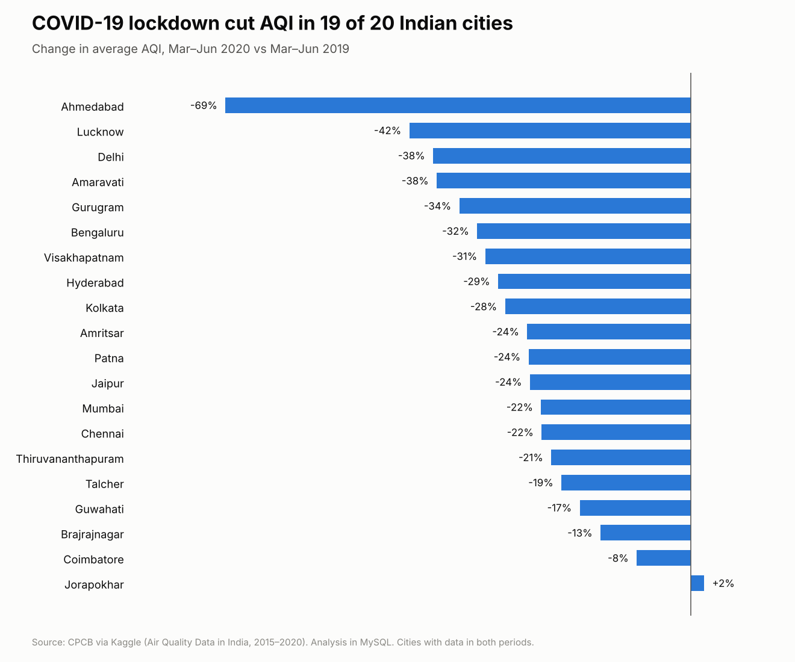
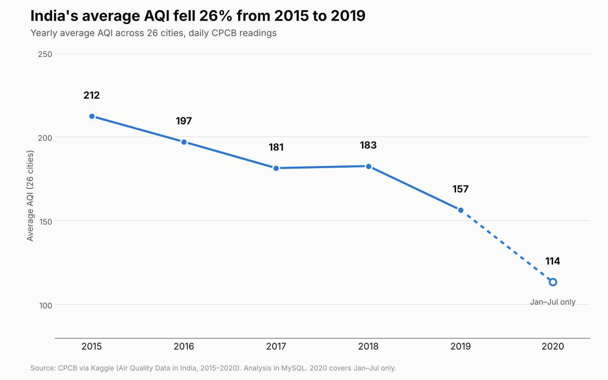

# Air Quality Analysis of 26 Indian Cities (2015-2020)

MySQL analysis of 29,531 daily air quality records from the Central Pollution Control Board (CPCB): data cleaning, CTEs, subqueries, window functions, and the impact of the COVID-19 lockdown.

## Key findings

- **Air quality improved over time.** Average AQI fell from 212 in 2015 to 157 in 2019, about 26% lower.
- **Winter is the worst season.** AQI peaks in November (242) and January (232), nearly double the July low (112).
- **Hotspots:** Ahmedabad, Delhi, Patna, Gurugram, and Lucknow have the highest average AQI. Each had more than 400 Severe or Very Poor days.
- **The lockdown cut pollution.** From March to June 2020, AQI fell in 19 of 20 cities compared with 2019: Lucknow -42%, Delhi -38%, Bengaluru -32%.
- **Kerala:** Kochi (104) has a higher average AQI than Ernakulam (92) and Thiruvananthapuram (76).

## Dataset

[Air Quality Data in India (2015-2020)](https://www.kaggle.com/datasets/rohanrao/air-quality-data-in-india) from Kaggle, sourced from CPCB. I used `city_day.csv`:

- 29,531 rows, 26 cities, 2015-01-01 to 2020-07-01
- Pollutants: PM2.5, PM10, NO, NO2, NOx, NH3, CO, SO2, O3, Benzene, Toluene, Xylene
- AQI and AQI_Bucket (Good, Satisfactory, Moderate, Poor, Very Poor, Severe)

## Data cleaning

- Converted empty strings to `NULL` (for example PM10 had 11,140 missing values and AQI had 4,681)
- Changed pollutant columns from text to `DOUBLE`
- Converted text dates to a `DATE` column with `STR_TO_DATE`
- Checked for duplicate city-date rows (none found)

## Questions answered

| Level | Questions |
|---|---|
| Basic (1-4) | First 10 records, Delhi records, unique cities and AQI buckets, all Severe days |
| Aggregation (5-10) | Overall averages, days per bucket per city, top 5 polluted cities, cities with 100+ Severe/Very Poor days (HAVING), yearly and monthly AQI |
| Intermediate (11-14) | Cities above average AQI (subquery), % of days per bucket, top 3 cities by PM2.5 (CTE), days with PM2.5 above 2x average |
| Advanced (15-19) | 3-month moving average, month-over-month change with `LAG()`, yearly city ranking with `RANK()`, COVID-19 lockdown comparison, Kerala comparison |

## SQL skills used

`GROUP BY` / `HAVING` · Subqueries · CTEs · `CASE WHEN` · `RANK()` · `LAG()` · Moving averages · Date functions · Data cleaning

## Limitations

- 2020 covers only January to July, so it isn't comparable to full years.
- Kochi and Ernakulam have about 155 days of data each, so the Kerala comparison is limited.
- Ahmedabad's 2015-2016 readings contain extreme values that inflate its average. The overall AQI trend still holds without Ahmedabad (about 30% decline from 2015 to 2019).

## Files

- `Air-Quality-Analysis-MySQL.sql`: all queries, from setup to the 19 questions
- `Air Quality_MySQL Project.pdf`: full report with query screenshots and insights
- `lockdown_aqi_change.png`, `yearly_aqi_trend.png`: charts

## How to run

1. Download `city_day.csv` from the Kaggle link above.
2. Run the setup section of the SQL file in MySQL Workbench to create the database and table.
3. Import the CSV with the Table Data Import Wizard.
4. Run the cleaning section, then the queries.

## Author

Shaimah P · [LinkedIn](https://www.linkedin.com/in/shaimah-p-8b9668386)
